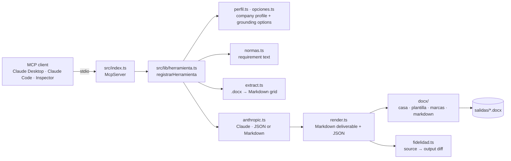

# ISO Agents — an MCP server that drafts ISO management-system documents clause by clause

[](https://github.com/edpauce/iso-agents/actions/workflows/ci.yml)


ISO Agents is a [Model Context Protocol](https://modelcontextprotocol.io) server written in
TypeScript. Each tool produces one documented deliverable of an **integrated management
system** (quality, environment, occupational health and safety, anti-bribery), following the
**Annex SL** high-level structure shared by ISO 9001, ISO 14001, ISO 45001 and ISO 37001.
Any MCP client (Claude Desktop, Claude Code, the MCP Inspector, your own agent) can call them.

It was built by a lead ISO auditor to automate the part of consulting work that is repetitive
but unforgiving: the model supplies domain judgement, **the code enforces the rules** that an
auditor would otherwise check by hand (nothing fabricated, nothing silently dropped, every
change visible, the standard's wording respected).

> Deliverables are produced in **Spanish** and anchored on the **Peruvian** legal framework,
> because that is who the tool serves. Everything in this repository (examples, fixtures,
> templates) is **fictional**; no client data or official ISO text is versioned.

## What makes it different

Most "ISO document generators" fill a template from scratch. This server works on the
**client's existing Word documents**:

| Capability | How it works |
|---|---|
| **Grounding** | Pass the client's current document (`documentoCliente` text or a `.docx/.txt/.md` path). Tables are extracted as a Markdown grid, merged cells included; an ambiguous merged cell emits an *extraction note* instead of letting the model guess. |
| **Update mode** | `modo: "actualizar"` keeps every entry of the client's document (one bullet = one entry), corrects what is obsolete against the current edition of the standard and adds what the standard now requires (e.g. climate change in 4.1/4.2, clause 4.2 c) in ISO 37001:2025). |
| **Client format** | `formato: "cliente"` replicates the client's own columns, scale and methodology instead of imposing a house template. |
| **Exact visual fidelity** | `plantillaPath` fills the client's own `.docx` template with [docxtemplater](https://docxtemplater.com/): colours, borders, header/footer and per-row shading survive. `scripts/docx-a-plantilla.ts` turns a real `.docx` into such a template once. |
| **Change tracking in colour** | Additions come out green, deletions red strike-through, inside the client's own runs, so the reviewer sees what changed at a glance. |
| **Fidelity guard** | After every update run the server diffs source → deliverable item by item and appends a report: fragments preserved (n/n), possible losses, additions to audit. It measures text, not the model's own change marks. |
| **Truncation guard** | A response cut at `max_tokens` is rejected, never delivered as if complete. A compliance matrix missing three rows is an audit finding, not a detail. |
| **Normative reference** | Each tool injects the text of the requirement it serves (`normas/`) so the output covers what the standard asks and nothing more. |

## Architecture



Every deliverable is declared as a `HerramientaSpec` (system prompt, render, Word render,
template data) and registered with one call. The shared pipeline applies grounding, mode,
format, normative reference, Word export and the fidelity guard uniformly, so a new clause is
one new spec file.

### Coverage by Annex SL clause

| Clause | Content | Status |
|---|---|---|
| **4. Context of the organization** | 4.1 issues (matrix, SWOT, PESTEL) · 4.2 interested parties · 4.3 scope · 4.4 processes | **Complete — 6 tools** |
| 5. Leadership | Policy, roles and responsibilities | Planned |
| 6. Planning | Risks and opportunities, objectives (risk assessment, aspects) | Planned |
| 7. Support | Competence, communication, documented information | Planned |
| 8. Operation · 9. Performance evaluation · 10. Improvement | Operational control, internal audit, corrective action | Planned |

Standards supported in the company profile: `9001`, `14001`, `45001`, `37001` (2025 edition).

## The six tools

All tools share the same input: a **company profile** plus **grounding options**.

```jsonc
{
  // Profile
  "nombre": "Textiles del Sur S.A.C.",          // required
  "sector": "Manufactura textil",               // required
  "tamano": "51-200",
  "productosServicios": "Tejido de punto y confección",
  "procesos": ["Diseño", "Tejido", "Confección", "Despacho"],
  "ubicacion": "Arequipa, Perú",                // default: Perú
  "normas": ["9001", "45001"],                  // default: ["9001"]
  "material": "Free text from real documents, for grounding",

  // Grounding options (all optional)
  "documentoCliente": "…current document as text…",
  "documentoClientePath": "ejemplos/cliente-partes-interesadas.md",
  "modo": "generar" | "actualizar",
  "formato": "casa" | "cliente",
  "exportarDocx": true,
  "plantillaPath": "ejemplos/plantilla-partes-interesadas.docx",
  "salidaPath": "salidas/"
}
```

Every tool returns a **Markdown deliverable** (title, company, requirement, body) followed by a
collapsible **JSON block** with the structured data, so tools can be chained (issues → SWOT →
risk planning). When a Word file is produced, its absolute path is appended; in update mode the
fidelity report closes the response.

| Tool | Requirement | Deliverable |
|---|---|---|
| `contexto_cuestiones_4_1` | 4.1 | Matrix of internal and external issues, each linked to the SWOT quadrant it feeds |
| `contexto_foda_4_1` | 4.1 | SWOT analysis plus the cross matrix of strategies (TOWS) |
| `contexto_pestel_4_1` | 4.1 | PESTEL analysis of external issues |
| `contexto_partes_interesadas_4_2` | 4.2 | Interested-parties matrix: needs, expectations, requirements, legal flag, follow-up; ISO 37001:2025 4.2 c) column when required |
| `contexto_alcance_4_3` | 4.3 | Scope statement with physical and organizational boundaries; exclusions only where ISO 9001 allows them, each justified |
| `contexto_mapa_procesos_4_4` | 4.4 | Process map with SIPOC view: suppliers, inputs, outputs, customers, indicators, owner |

<details>
<summary><strong>Example — <code>contexto_partes_interesadas_4_2</code> in update mode with the client's template</strong></summary>

Input:

```json
{
  "nombre": "Financiera del Altiplano S.A.",
  "sector": "Servicios financieros",
  "normas": ["37001"],
  "documentoClientePath": "ejemplos/matriz-vigente-2016.docx",
  "modo": "actualizar",
  "plantillaPath": "ejemplos/plantilla-antisoborno-partes-interesadas.docx"
}
```

Output (abridged, illustrative):

```markdown
# Matriz de Partes Interesadas

**Empresa:** Financiera del Altiplano S.A.
**Requisito:** 4.2 Comprensión de las necesidades y expectativas de las partes interesadas

## Partes interesadas internas (4)
| Parte interesada | Necesidades y expectativas | Requisitos para el SIG | ¿Legal? | Influencia | Seguimiento | Abordado mediante el sistema de gestión |
| --- | --- | --- | --- | --- | --- | --- |
| Directorio | Confianza de los grupos de interés<br>Involucramiento de la plana gerencial | Revisión periódica del desempeño del sistema | No | alta | Revisión por la dirección | Revisión por la dirección (9.3) |
| Colaboradores | Ambiente laboral con integridad | Canales de denuncia y protección al denunciante | Sí | media | Canal de denuncias | Canal de denuncias (8.9) |
…

---
<details><summary>Datos estructurados (JSON — para reuso entre herramientas)</summary>
{ "partes": [ { "parte": "Directorio", "tipo": "interna", … } ] }
</details>

---
📄 Plantilla del cliente rellenada — identidad visual exacta:
   /…/salidas/4.2-matriz-de-partes-interesadas-1760000000000.docx
🔎 Fragmentos del origen conservados: 40/40 (100%)
✅ Sin posibles pérdidas.
➕ Adiciones no presentes en el origen (3) — confirmar que respondan a la norma:
   · Determinar si el cambio climático es una cuestión pertinente
   · Canal de denuncias (8.9)
   …
```

In the generated `.docx` the new column and the new rows are green, the obsolete reference is
red strike-through, and the client's shading per row (internal vs. external) is preserved.
</details>

<details>
<summary><strong>Minimal inputs and outputs for the other five tools</strong></summary>

**`contexto_cuestiones_4_1`** — `{ "nombre": "Textiles del Sur S.A.C.", "sector": "Manufactura textil", "normas": ["9001","45001"] }`
→ two tables (internal / external) with columns *Categoría · Cuestión · Tendencia · Impacto potencial en el SIG · FODA*, 12–20 issues, each tagged F/O/D/A.

**`contexto_foda_4_1`** — same profile, optionally `documentoClientePath: "ejemplos/cliente-foda-2019.md", modo: "actualizar"`
→ SWOT lists, then the cross matrix (FO · FA · DO · DA strategies). In update mode the 2019 reference to ISO 9001:2008 is corrected and the missing cross matrix is added; the fidelity report confirms no original item was lost.

**`contexto_pestel_4_1`** — same profile
→ one table per PESTEL dimension: *Factor · Descripción · Implicancia para el SIG · Tendencia*, anchored on Peruvian regulators where relevant.

**`contexto_alcance_4_3`** — profile with `productosServicios`, `procesos`, `ubicacion`
→ formal scope statement (quoted), products and services covered, physical boundaries (sites), organizational boundaries (units), processes included, exclusions table (ISO 9001 only, each with a justification; empty for 14001/45001/37001).

**`contexto_mapa_procesos_4_4`** — profile with `procesos`
→ processes grouped as strategic / operational / support, one SIPOC row each (supplier, inputs, outputs, customer, indicator, owner) and the interactions between them.

Add `"exportarDocx": true` to any call to also get a house-format Word file.
</details>

## Running it

Requirements: Node ≥ 20.12 (tested on 22) and an Anthropic API key. The key lives **only** in
the server's environment; the MCP client never sees it.

```bash
git clone https://github.com/edpauce/iso-agents.git
cd iso-agents
npm ci
cp .env.example .env.local     # then set ANTHROPIC_API_KEY
```

### Claude Desktop

Add the server to `claude_desktop_config.json`
(macOS: `~/Library/Application Support/Claude/claude_desktop_config.json`,
Windows: `%APPDATA%\Claude\claude_desktop_config.json`), then restart Claude Desktop:

```json
{
  "mcpServers": {
    "iso-agents": {
      "command": "npx",
      "args": ["tsx", "/absolute/path/to/iso-agents/src/index.ts"],
      "env": { "ANTHROPIC_API_KEY": "<your key>" }
    }
  }
}
```

Or compile once (`npm run build`) and point `command` to `node` with
`args: ["/absolute/path/to/iso-agents/dist/index.js"]`. The six tools appear under the
server name; ask Claude, for example: *"Usa contexto_partes_interesadas_4_2 para Textiles del
Sur S.A.C., sector manufactura textil, normas 9001 y 45001, y exporta a Word."*

### Claude Code

```bash
claude mcp add iso-agents --env ANTHROPIC_API_KEY=<your key> -- npx tsx "$(pwd)/src/index.ts"
```

The repository also ships a `.mcp.json`, so opening the folder in Claude Code offers the server
(named `ehsq`) automatically; it reads the key from `.env.local`.

### MCP Inspector (manual testing in the browser)

```bash
npm run inspect
```

`ejemplos/README.md` lists five ready-made trials (client format, update mode, house Word,
client template, ISO 37001 template) using the fictional company *Textiles del Sur S.A.C.*

### Demo

A short recording of the server inside Claude Desktop belongs here. To make one:

1. Register the server as above and restart Claude Desktop.
2. Record the screen (macOS: ⌘⇧5, or [Kap](https://getkap.co/) for a GIF) while you ask for the
   4.2 matrix of *Textiles del Sur S.A.C.* with `exportarDocx: true`, then open the `.docx`.
3. Keep it under 30 s, save it as `docs/demo.gif` and reference it here:
   ``.

Use fictional company data in the recording.

## Tests

```bash
npm ci && npm test
```

39 tests in about two seconds, **no API calls, no client data**. Fixtures are synthetic
(`test/helpers.ts`, `test/fixtures/`) and reproduce the pathologies met on real documents:

- extraction keeps tables as a grid; an ambiguous merged cell produces a note, never a guess;
  truncated source text arrives verbatim;
- change marks colour the right fragment, keep the run's own properties and leave no residue;
- enumerated fields with change marks do not empty the document; the ISO 37001 4.2 c) column
  comes from the model, never a hardcoded "Sí"; lists stay lists;
- the normative loader prefers official text, falls back to the paraphrased guide and never
  invents a requirement that the standard does not have;
- end to end: a client `.docx` → template with two prototype rows and an extra column → filled
  document with the right shading per row, one bullet per item, green/red changes, and every
  input item present in the output;
- the fidelity guard reports losses and additions, tolerates light rewording, is not fooled by
  change marks and does not count an item cited only in *Cambios realizados* as preserved.

The tests name the case that motivated them, so nobody deletes them as redundant.

## Limitations and things to know

- **Clause 4 only.** Clauses 5–10 are planned; the framework is ready (`HerramientaSpec`).
- **Spanish output, Peruvian legal anchors** (SUNAFIL, OEFA/MINAM, Indecopi, Ley 30424…).
  Other jurisdictions need the prompts in `src/tools/` adjusted.
- **Official ISO text is not included.** It is copyrighted. The repository ships paraphrased
  guides (`normas/comun/`); if you hold a licence, drop the requirement text in
  `normas/<standard>/<code>.md` and it takes precedence (`.gitignore` keeps it local).
- **Documents travel to the Anthropic API.** Before processing a real client's document, make
  sure you have the client's consent and that your data-handling agreement allows it.
  Anthropic does not train on API data by default; check the current terms.
- **The model is not deterministic.** The guards catch truncation, fabrication of fixed values
  and content loss; they do not replace the auditor's review. Treat every green addition as a
  proposal.
- **PDF input is not supported** (convert to `.docx` or paste the text). The default model is
  `claude-sonnet-5`; override with `ANTHROPIC_MODEL`.

## Project layout

```
src/
├─ index.ts                 # MCP entry point (stdio), registers the tools
├─ lib/
│  ├─ herramienta.ts        # framework: HerramientaSpec + registrarHerramienta
│  ├─ perfil.ts             # company profile schema (zod)
│  ├─ opciones.ts           # grounding options: document, mode, format, export
│  ├─ extract.ts            # .docx/.txt/.md → Markdown (tables as grid)
│  ├─ normas.ts             # loads the requirement text from normas/
│  ├─ anthropic.ts          # Claude client, JSON/Markdown generation, truncation guard
│  ├─ fidelidad.ts          # runtime fidelity guard (source → output diff)
│  ├─ render.ts             # Markdown helpers, deliverable envelope
│  └─ docx/                 # casa (house Word), plantilla (docxtemplater), marcas (colours), markdown→docx, salida
└─ tools/clausula4/         # one file per deliverable (4.1 ×3, 4.2, 4.3, 4.4)
normas/                     # paraphrased guides + placeholders for licensed text
ejemplos/                   # fictional client documents and templates
scripts/                    # docx-a-plantilla, md-a-docx, template generators
test/                       # 39 tests, synthetic fixtures
```

## Stack

[@modelcontextprotocol/sdk](https://github.com/modelcontextprotocol/typescript-sdk) ·
[@anthropic-ai/sdk](https://github.com/anthropics/anthropic-sdk-typescript) · zod ·
[docx](https://docx.js.org/) · [docxtemplater](https://docxtemplater.com/) · mammoth · TypeScript (ESM) · Node test runner.

## License

[MIT](LICENSE) © 2026 Edson Palomino. ISO standards are the property of ISO; this project
does not redistribute their text.
